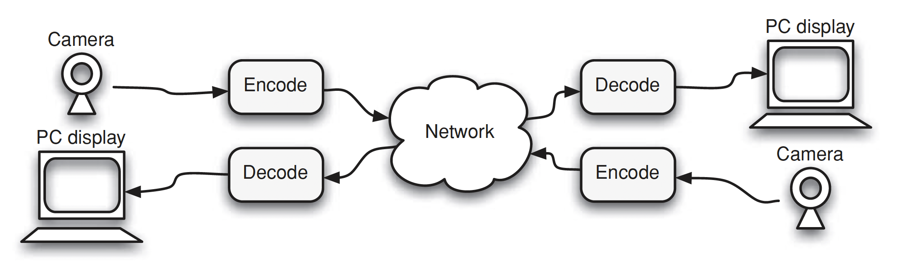

Video compression or video encoding is the process of reducing the amount of data required to
represent a digital video signal, prior to transmission or storage. The complementary operation,
decompression or decoding, recovers a digital video signal from a compressed representation, prior
to display.

Digital video data tends to take up a large amount of storage or transmission capacity and so video
encoding and decoding, or video coding, is essential for any application in which storage capacity
or transmission bandwidth is constrained.

An encoder compresses or encodes an input video signal into a coded bitstream, and a decoder, which
decompresses or decodes the coded bitstream to produce an output video signal.

Standard

H.264 
MPEG-4 Part 10 
Advanced Video Coding

The output of a CCD array is an analogue video signal, a varying electrical signal that represents
a video image. Sampling the signal at a point in time produces a sampled image or frame that
has defined values at a set of sampling points.

- Progressive sampling:
- Interlaced sampling: 

Color space

A monochrome image requires just one number to indicate the brightness or luminance of each spatial
sample. On the other hand, color images require at least 3 numbers per pixel position to accurately
represent color. The method chosen to represent brightness, luminance or luma and color is described
as color space.
